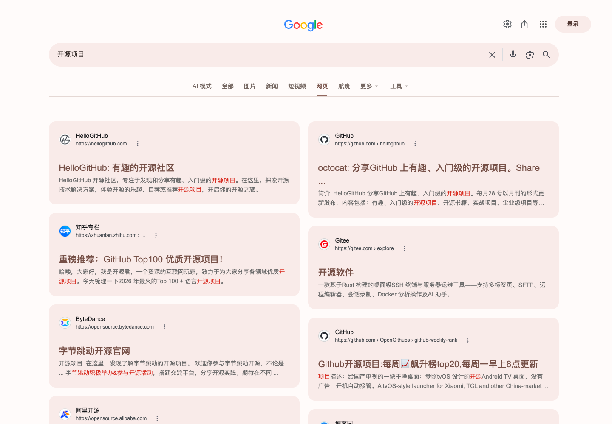
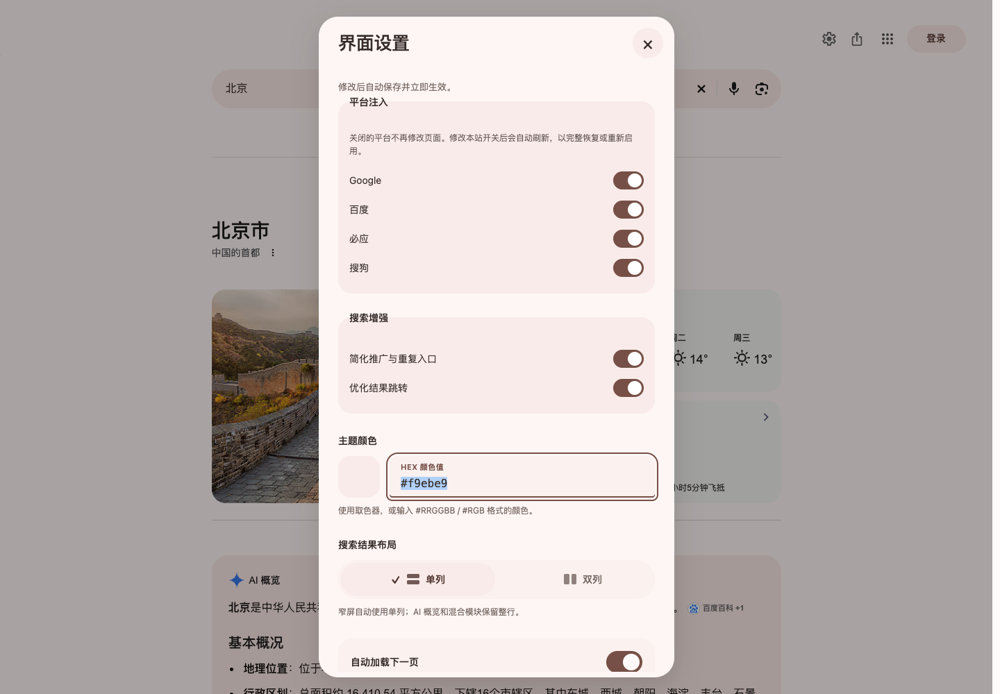
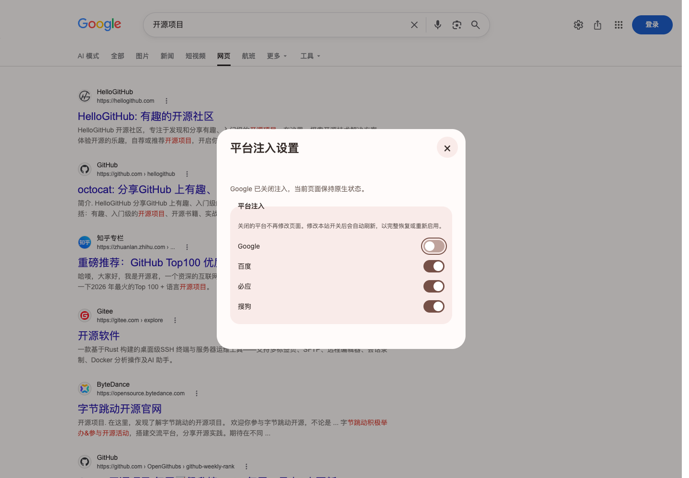
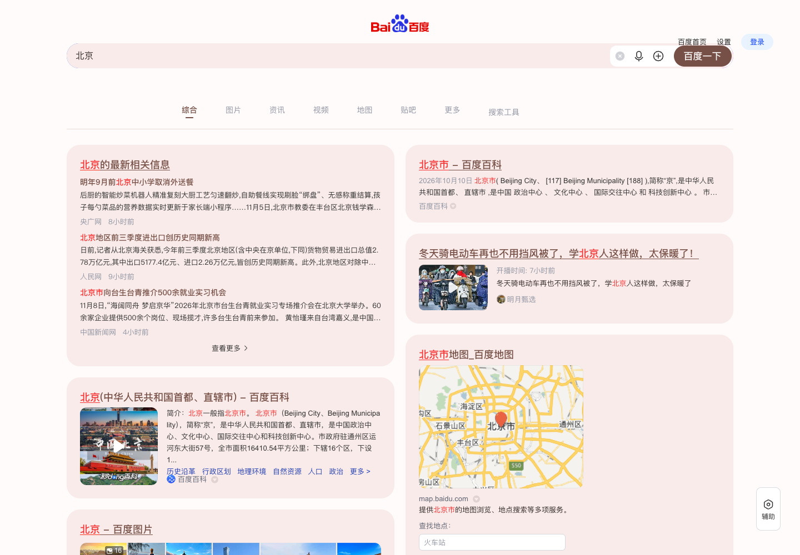

# 谷歌搜索样式优化 · MD3 风格

采用 Material Design 3（MD3）风格，以 Google 为主，兼容百度、必应与搜狗的搜索结果页美化脚本。当前版本：**1.9.19**。

## 预览

搜索布局为 1.9.17 实页截图，单列与双列使用同一组结果；设置弹窗及三站预览已更新至 1.9.19。

### 双列瀑布流



### 单列布局


### 界面设置



关闭注入后的设置入口：



### 其他搜索站点

以 Google 完成版的居中轴线、主题色、圆角和卡片间距为基准，保留各站原生内容与交互。

| 百度 | 必应 | 搜狗 |
| --- | --- | --- |
|  |  |  |

## 安装

1. 安装暴力猴或 Tampermonkey。
2. 点击 [安装统一脚本](https://raw.githubusercontent.com/ZOUYIQAQ/Better-Google-Search/main/search-quiet-cards.user.js)，在脚本管理器中确认安装。
3. 打开搜索结果页。旧版独立脚本请手动停用，避免重复运行。

只需安装 `search-quiet-cards.user.js` 一份文件。

## 功能

- 柔和主题色、圆角卡片，支持单列及双列瀑布流。
- Google AI 概览置顶并跨双列，相关问题、推荐搜索、图片和地点模块融入卡片布局。
- 卡片空白处可打开主链接，保留原生按钮、菜单和文字选择。
- 标题悬停时显示仅覆盖文字的细下划线动画。
- 默认自动加载下一页；遇到验证或请求异常时暂停，并提供操作入口。
- 默认隐藏带有明确广告标记的内容，可在设置中关闭。
- 设置实时保存和生效，右上角关闭按钮常驻；页面不添加悬浮设置按钮。
- 完整展开的可读源码，无远程代码依赖。

## 设置入口

点击脚本管理器图标，在本脚本下方选择 **“界面设置”**。各搜索站点独立保存外观配置。

“平台注入”可分别关闭 Google、百度、必应、搜狗。修改当前平台时会自动刷新一次，使已添加的样式、卡片、链接改动、广告过滤及翻页功能完整退出。关闭后再次刷新仍保持原生页面，只保留管理器设置入口用于重新开启。其他已打开的对应平台标签页也会同步刷新还原；关闭一个平台不会关闭其余平台。

## 1.9.19 更新

- 参考 AC-baidu 的分项增强思路，独立实现“简化推广与重复入口”“优化结果跳转”两个实时开关，按搜索平台独立保存。
- 简化百度热榜、App 下载浮条和部分扩展分类；简化搜狗热榜、重复推荐、底部重复搜索框及部分扩展分类。保留搜索、筛选、无障碍、设置和微信搜索。
- 百度使用结果元数据还原目标，必应解码普通结果跳转参数，Google 还原明文目标参数。无法确认的搜狗加密跳转继续使用原链接；不批量访问目标网页，不新增跨站请求权限。
- 修正搜狗相关搜索卡片横向溢出，压缩 AI 正在生成时的固定空白。
- 实际使用无头 CloakBrowser、持久配置与暴力猴安装，在四个平台各测“北京”“Python 教程”“附近咖啡店”，并验证开关恢复、原生搜索重建和直达链接实际落点。25 项 Node 测试与 78 项辅助扩展回归通过。

## 1.9.18 更新

- 新增四个平台的独立注入开关，放在唯一的设置弹窗中，实时保存。
- 禁用平台在所有页面功能之前直接返回，不创建样式、页面标记、页面监听器或翻页／点击代理；只保留管理器设置入口和平台偏好同步。
- 修改本站开关自动刷新，彻底还原已运行的增强；支持跨标签同步，刷新后仍保持关闭。
- 关闭状态下也可以从管理器打开平台设置并重新开启。
- 持续参考 AC-baidu 的站点分层、广告标记与分页处理经验，保留现有 MD3 风格和原生交互。

## 1.9.17 更新

- 修复百度重复搜索框、原生搜索更新后样式丢失，以及原生搜索入口参数导致的翻页暂停。
- 统一百度、必应、搜狗的居中布局和单列／双列宽度；修复窄屏页码溢出。
- 地图、图片、天气、百科和推荐词使用卡片布局；已有卡片保留列位，延迟出现的非 AI 模块不插到正在阅读的结果上方。
- AI 正文置顶跨列，未生成实际回答时隐藏空壳；保留原生展开、引用和地图交互。
- 对照 AC-baidu 补齐广告标记，加入实页确认过的必应图片广告徽标识别；普通“网页”徽标不会被当成广告。
- 设置弹窗以 180ms 轻微淡入、上移出现，尊重系统减少动态效果；右上角关闭按钮常驻。
- 设置和广告规则在站点重建头部后自动恢复；实时保存和唯一设置入口保持不变。

## 1.9.16 更新

- 修复原生卡片包含隐藏标题时，点击空白区域找不到主链接的问题。
- 短按空白处打开对应网页；长按至少 500ms、拖动超过 8px、文字选择或上下文菜单操作不触发跳转。
- 保留链接、按钮、菜单的独立交互；长按标题链接也不会因随后生成的点击误跳转。
- 包含点击后下划线残留修复，保留键盘焦点提示。

## 1.9.15 更新

- 修复点击搜索结果后，该卡片标题下划线因残留鼠标焦点而一直显示的问题。
- 下划线仅在鼠标悬停或键盘可见焦点时展开，保留键盘操作提示。

## 1.9.14 更新

- 修复导航栏下方重复分隔线：新导航出现后，撤销旧工具容器的导航外壳标记，保留原生工具交互。
- 重新拍摄单列、双列与设置弹窗预览图。

## 1.9.13 更新

- 明确脚本更新和下载地址，菜单注册统一为“界面设置”，不带省略号。

## 1.9.12 更新

- 去掉脚本管理器中“界面设置”菜单后的省略号，四个搜索站点统一。

## 1.9.11 更新

- 修复点击“展开 AI 概览”时页面追随底部按钮、看起来向上展开的问题。
- 展开时以当前卡片起点为锚点，新增内容向下延伸；用户继续滚动时恢复普通阅读跟随。
- 兼容位于结果流内部和独立顶部区域的 AI 卡片，并保留问答、更多内容的原生交互。

## 1.9.10 更新

- 补齐 Google 另一种 AI 追问框外层结构，清除更外层的底部吸附，避免遮挡引用卡片。
- 修复更名前后脚本并存时，旧版先初始化导致新版追问样式被跳过的问题；输入样式可独立补齐，布局不会重复初始化。
- 使用用户保存的实际页面结构复现并检查，同时在真实 Google 搜索页复查输入和窄屏效果。

如果安装后仍显示旧效果，请在管理器中确认已安装最新版本，并停用旧名“搜索 · 静谧卡片”脚本后刷新。重命名可能使管理器保留两个条目。

## 1.9.9 更新

- AI 概览展开后的追问框与正文等宽，移除白色渐变外壳、叠加阴影和遮挡正文的悬浮定位。
- 输入框、附件和语音按钮沿用主题色，补齐焦点描边和发送按钮对比度。
- 保留原生输入、附件、语音与发送事件；在真实 Google 搜索页检查双列、单列及窄屏输入效果。

## 1.9.8 更新

- 页面主体出现即初始化，按绘制帧处理流式结果，减少延迟排版造成的跳动。
- 首次布局不主动滚动，后续布局按阅读锚点补偿位置。
- 提前识别 Google 无标题 AI 生成骨架，减少生成完成后的重排。
- 保留重排及加载过程中的向下滚动意图，到底后无需先上滚再下滚才能续页。

## 验证与边界

2026-11-06 使用真实无头 CloakBrowser、持久配置和暴力猴安装脚本，在 Google `ttorc`、`sam3` 搜索页完成初始化、滚动和连续翻页的录屏及逐帧检查；62 项辅助扩展回归与 5 项加载事件时序测试通过。

1.9.17 使用真实无头 CloakBrowser、持久配置和暴力猴安装脚本，对百度、必应、搜狗分别测试“北京、鲁迅、飞书、Python asyncio、iPhone 17、上海天气、猫咪图片”，覆盖 21 个实页，并检查单列、双列及窄屏截图。另在四站复查真实设置菜单，在三站原生输入框按回车搜索“开源软件”，验证设置刷新后保留，并在必应、搜狗确认实际广告隐藏与恢复。百度、必应在原生搜索后的真实页面均实际自动追加了23张结果卡片。

1.9.18 另在四站实页验证关闭、刷新后保持原生、设置入口与重新启用，以及跨标签同步；关闭状态下自有样式、节点和页面属性均为 0。78 项辅助扩展回归、23 项事件与分页／广告识别／平台隔离测试通过，辅助结构页不代替上述实页验收。Google 是主要适配目标，搜索网站的页面结构会变化；本轮样本不代表所有关键词、广告形式或未来页面版本均已覆盖。

自动追加仅提取普通网页结果；复杂交互内容请通过原生完整分页查看。搜狗没有可识别的下一页链接时保留原生机制，不伪造下一页地址。广告过滤以明确标记识别，不保证覆盖所有投放形式。

## 本地检查

需要 Node.js：

```sh
node --check search-quiet-cards.user.js
node --test tests/*.test.cjs
```

## 参考

广告识别思路参考 [AC-baidu](https://greasyfork.org/zh-CN/scripts/14178)，采用独立的可恢复隐藏实现。暴力猴注入环境配置见[官方元数据文档](https://violentmonkey.github.io/api/metadata-block/#inject-into)。

## 许可证

[MIT](LICENSE)
